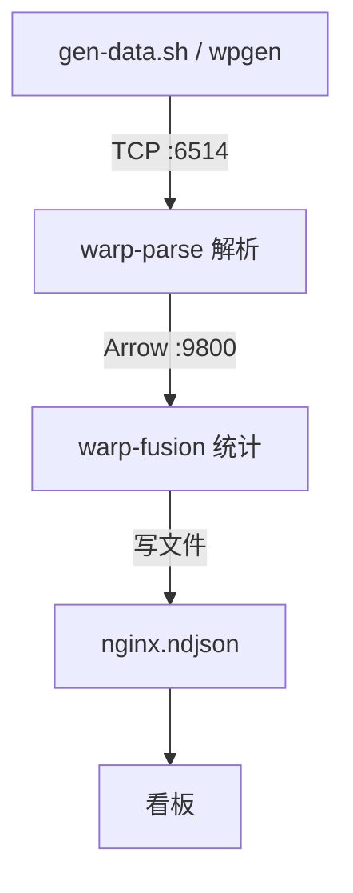

# web-stats

**一句话**：把 nginx access 日志**认出来**（warp-parse 解析），再**算出统计**（warp-fusion 窗口统计），
结果写成文件给看板看。

整个系统只有两块干活的引擎，加一层把它们接起来的配置：

- **warp-parse** —— 认日志。把 `222.133.52.20 - - [06/Aug/...] "GET /x HTTP/1.1" 200 368 ...` 这样的一行，
  切成 `client_ip / recv_time / uri / http_status / bytes_sent / referer / user_agent` 这些字段。
- **warp-fusion** —— 算。按时间窗口分组统计，或者做实时告警。
- **sys/** —— 把两者接起来的线，以及"这个系统要统计什么"的业务配置。

---

## 跑起来之后，一步步发生了什么



1. **你敲 `sh sys/gen-data.sh`**。
   它调 `wpgen` 造出一批 nginx 日志行，通过 TCP 发到 `127.0.0.1:6514`。
   （正常情况下这一步的输入是线上的真日志，demo 用生成的代替。）

2. **warp-parse 在 6514 上收。**
   每收一行，就用 `spec/models/wpl/parse.wpl` 里的规则把它切成字段（上面那 7 个）。

3. **切完的字段，warp-parse 顺手发出去。**
   用 Arrow 这种二进制格式，通过 TCP 发到 `127.0.0.1:9800`。
   每一帧自带一个"名字"，这个名字就是 OML 文件里的 `name : nginx`，所以叫 `nginx`。

4. **warp-fusion 在 9800 上收。**
   它看帧上带的名字 `nginx`，去找同名的窗口 —— 也就是 `nginx_access` 这个事件窗。
   （窗口 = 一块按时间滚动、但只在内存里保留一小段时间的地方。）

5. **窗口里的规则每 5 秒结算一次**（叫"固定桶"：每 5 秒一个桶，桶满了就出结果）：

   | 规则 | 算什么 | 出什么 |
   | --- | --- | --- |
   | `nginx_status_stats` | 按状态码分组 | 每个状态码：请求数、其中 5xx 数、独立客户端数 |
   | `nginx_ip_stats` | 按来源 IP 分组 | 每个 IP：请求数、其中 5xx 数 |
   | `nginx_5xx_surge` | 实时盯 | 同一个 IP 一分钟内 5xx 到 3 次，立刻出一条告警 |

6. **结果写进文件**，一行一条 JSON：
   `sys/arm-mac14-host/mods/warp-fusion/local/data/alerts/nginx.ndjson`
   看板 `sys/view` 每 3 秒重读这个文件，所以数据是"滚着涨"的。

---

## 为什么配置分成"模块"和"系统"两半

这是最容易被绕晕的地方，说清楚原理就不难了。

- **引擎自己的本事**，跟业务无关 —— "怎么把日志切字段"、"有哪些连接器"、"怎么下载/启动"。
  这些放在**模块仓库**里（warp-parse / warp-fusion），换一个业务、换一个现场，模块还是那个模块。

- **这个系统要干的活** —— "统计 nginx 的哪些东西"、"结果写到哪"、"喂数据从哪进"。
  这些放在 `sys/setting/<模块>/` 下。系统启动时会把这些文件**整份盖到**模块里同名的路径上
  —— 注意是**整份替换，不是合并**，所以文件名一样就等于接管那个文件。

> 记一句就够：**改"怎么认日志" → 去模块仓库；改"统计什么、写到哪" → 去 `sys/setting`。**

举两个具体例子：

- *想改成按 URI 统计*：改 `sys/setting/warp-fusion/models/rules/01-stats/` 下的规则（把 `group by (c.http_status)` 换成 `c.uri`），
  不用动模块。
- *想改字段名*：那是"怎么认日志"，得改模块里的 WPL（`warp-parse/mod/<model>/spec/models/wpl/parse.wpl`），
  同时把 warp-fusion 侧的窗口字段一起改。

### 要对上的三件事

集成能不能通，就看这三处名字对得上：

1. **帧上的名字 = OML 的 `name` = 窗口的 `stream_tag`。**
   现在三处都是 `nginx`（OML `name : nginx` ↔ `window nginx_access { stream_tag = "nginx" }`）。
   改一处忘了另两处，数据就进不了窗口。

2. **窗口字段 = WPL 产出的字段。**
   warp-parse 切出什么字段名，窗口就得声明什么字段名、类型对得上。
   注意字段名**不能带 `/`**——warp-fusion 里写的是 `c.http_status`，`http/status` 会被当成路径解析不了。

3. **输出窗口 = 一条结果的结构。**
   `nginx_alerts` 这个窗口的字段就是"一行统计/告警长什么样"，规则往里填。

---

## 怎么跑

```sh
# 1) 装配：同步模块 + 生成模块的 local/ + 装二进制
gops sys update
gops sys localize
gops sys install

# 2) 起两个引擎（顺序有讲究，见下面「出问题先看这三处」第 1 条）
gops sys start

# 3) 造点数据喂进去
sh sys/gen-data.sh -n 2000

# 4) 打开看板
sh sys/view/serve.sh        # → http://localhost:8123/view/
```

跑起来之后，东西分别落在哪：

```
sys/arm-mac14-host/bin/                 # 两个引擎的二进制
sys/arm-mac14-host/local/cache/         # 下载下来的安装包（整个 host 共用）
sys/arm-mac14-host/mods/<模块>/local/   # 每个模块的工作目录（配置、模型、日志、输出）
```

---

## 出问题先看这三处

| 现象 | 多半是 | 怎么办 |
| --- | --- | --- |
| `gops sys start` 报 `started ...` 但一会儿就没了 | **启动顺序**：warp-parse 一启动就要连 warp-fusion，那时 fusion 还没起 | 确认 `sys/mod_list.yml` 里 **warp-fusion 排在 warp-parse 前面**，然后重启 |
| `gen-data.sh` 说"目标没在监听" | 下游没起 | `gops sys start`，再跑 `gen-data.sh` |
| warp-fusion 报 `validate window over vs over_cap` | 新加的窗口没在 `windows.toml` 里登记 | 每个窗口都要在 `sys/setting/warp-fusion/models/schemas/windows.toml` 有一条，这个文件只能整份替换 |

其余两条经验：

- **`gops sys localize` 会把模块的 `local/` 清空**（包括二进制）。所以安装包和二进制都放到了模型级
  （`sys/<model>/local/cache`、`sys/<model>/bin`），不受影响；但每次 localize 之后还是要 `gops sys install` 一次。
- **`wpgen` 的配置文件路径是按"当前目录"找的**（`-w` 只管工作根），所以要在模块的 `local/` 里跑它
  —— `sys/gen-data.sh` 已经处理了。

---

## 附：哪个文件管哪一截

| 文件 | 管什么 |
| --- | --- |
| `sys/mod_list.yml` | 有哪些模块；**顺序就是启动顺序** |
| `sys/setting/list.yml` | `sys/setting/` 里的文件盖到模块的哪个路径 |
| `sys/setting/warp-parse/conf/wpgen.toml` | 造出来的数据发给谁（改成发到 6514，而不是写文件） |
| `sys/setting/warp-parse/topology/sinks/business.d/fusion.toml` | 解析结果用 Arrow 发到 9800 |
| `sys/setting/warp-fusion/models/schemas/nginx.wfs` | 事件窗口 `nginx_access` + 结果窗口 `nginx_alerts` |
| `sys/setting/warp-fusion/models/schemas/windows.toml` | 窗口登记表（模块原有的窗口 + nginx 两个） |
| `sys/setting/warp-fusion/models/rules/01-stats/*.wfl` | 两个分组统计 |
| `sys/setting/warp-fusion/models/rules/02-alert/nginx_5xx_surge.wfl` | 5xx 突发告警 |
| `sys/setting/warp-fusion/topology/sinks/business.d/nginx.toml` | 结果写到 `data/alerts/nginx.ndjson` |
| `sys/gen-data.sh` | 造数据喂进链路 |
| `sys/view/index.html`、`serve.sh` | 看板 |

模块仓库里跟着一起改过的地方（属于"怎么认日志"这一层）：

- `mod/<model>/spec/models/wpl/parse.wpl` —— 字段改名成不带 `/` 的写法
- `mod/<model>/connectors/sink.d/18-tcp_sink.toml` —— 放开 `data_format`，Arrow 输出才发得出去
- `mod/<model>/workflows/operators.gxl` —— 安装包/二进制放到模型级目录

---

## 现状

全链路已验证通过（`wfl lint` 无错、`wproj check` 通过、喂数据后统计持续产出、看板可读）。

**布局**：`sys/setting/list.yml` 的 `dst` 已切到新目录布局
`sys/<model>/mods/<模块>/local/`（gops ≥ 1.3.5），`gops sys localize` 会把系统配置盖进模块的
`local/`，不会再落到模块外面。
